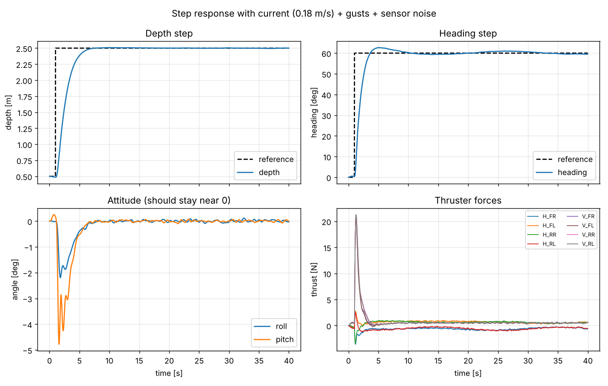
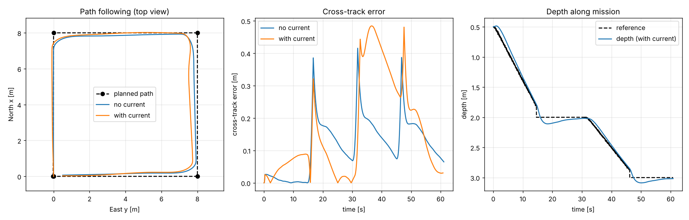

# modular-auv-control

A hardware-agnostic control stack for a small ROV/AUV, built simulation-first.
The same controller, guidance and thruster-allocation code is meant to drive a real vehicle later by swapping one class.

```
Guidance (LOS waypoints) -> Controller (cascaded PID) -> Allocator (tau -> 8 thrusters) -> VehicleInterface
                                                                                          |-- SimulatedVehicle (done)
                                                                                          `-- RealVehicle     (phase 2)
```

## Run it

```bash
pip install -r requirements.txt
python -m pytest -q        # 8 tests
python run_demo.py         # writes results/*.png and results/metrics.json
```

## What is in here

| File | Role |
|---|---|
| `auv/vehicle.py` | 6-DOF Fossen-style dynamics (added mass, drag, restoring forces, ocean current, thruster lag), RK4, noisy sensors |
| `auv/thrusters.py` | 8-thruster (4 vectored horizontal + 4 vertical) geometry, min-norm allocation with direction-preserving saturation |
| `auv/controller.py` | Depth, heading, roll/pitch and body-speed loops, conditional-integration anti-windup |
| `auv/guidance.py` | Line-of-sight path following between 3-D waypoints |
| `auv/interfaces.py` | **The hardware boundary**: `read_state()`, `send_thrust()`, `advance()` |
| `auv/sim.py` | Closed-loop runner, step-response and cross-track metrics |

## Results (simulation, 0.18 m/s current + gusts + sensor noise)

| Test | Result |
|---|---|
| Depth step 0.5 -> 2.5 m | rise 2.9 s, overshoot 0.4 %, settles in 5.0 s |
| Heading step 0 -> 60 deg | rise 1.6 s, overshoot 4.4 %, settles in 7.1 s, 0.4 deg residual |
| 32 m waypoint mission with current | cross-track RMS 0.22 m (max 0.48 m); without current 0.15 m (max 0.42 m) |
| Peak roll/pitch during steps | about 5 deg |




## Known limitations (read before trusting the numbers)

- Vehicle parameters are BlueROV2-class approximations, not an identified model of any real vehicle.
- The controller is tested against the same model family it was tuned on. Good sim results show the design is sound, not that it will work on hardware.
- The simulator provides x/y position and ground-referenced velocity (as a DVL + position fix would). A low-cost vehicle will not have these. See roadmap.
- Depth reference has a small step at waypoint switches (segments are switched before the exact endpoint).
- No state estimator yet: the controller uses noisy measurements directly.

## Roadmap

1. **Sensor realism**: remove x/y position, add an EKF (IMU + pressure + optional DVL), run the controller on estimates.
2. **A second controller** (sliding-mode or adaptive) benchmarked against the PID baseline on the same scenarios.
3. **Failure tests**: thruster loss, saturation, current steps, sensor dropout.
4. **Hardware phase**: implement `RealVehicle(VehicleInterface)` for the target board, run the controller loop at a fixed rate, test tethered in a pool with a kill switch.
